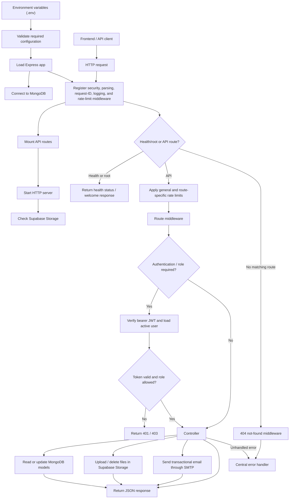
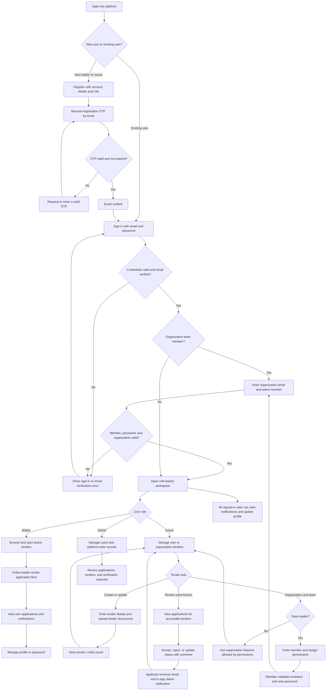
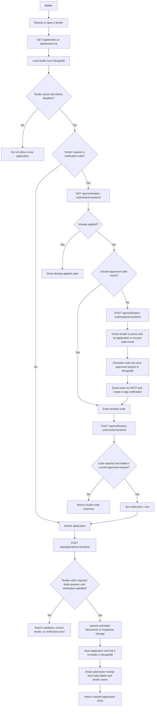

# FSS Backend System Flow

This document summarizes the backend startup sequence, API request pipeline, and
the main tender-bidding workflow implemented in this repository.

## System overview

## User flow

This view follows the people using the platform, from account access through
their main bidder, issuer, team-member, or admin tasks.

## Bidder tender application flow

Code verification is required only when the tender's `verificationCode` field is
set. Verification requests are auto-approved when created; the issuer/admin
approval routes still exist for managing requests.

## Main API areas and data

| API area | Purpose | Main MongoDB models / services |
| --- | --- | --- |
| `/api/auth` | Registration, OTP verification, login, profile, password recovery, and admin user management | `User`, SMTP email |
| `/api/team-auth` | Shared-email team-member lookup and team login | `User`, `TeamMember` |
| `/api/tenders` | Public tender listing/details; issuer/admin tender creation and management | `Tender`, `Application`, Supabase Storage |
| `/api/applications` | Bidder submissions and issuer/admin review or status changes | `Application`, `Tender`, `Notification`, Supabase Storage, SMTP |
| `/api/verification-code` | Request, verify, and inspect bidder codes; issuer/admin request management | `VerificationCodeRequest`, `Tender`, `Application`, `Notification`, SMTP |
| `/api/organizations` | Organization details, statistics, updates, and deactivation | `Organization`, organization/team permissions |
| `/api/team-members` | Invitations, team membership, and permissions | `TeamInvitation`, `TeamMember`, `User`, SMTP |
| `/api/notifications` | List, read, and clear the current user's notifications | `Notification` |
| `/api/activity-logs` | Organization, member, and resource activity reports | `ActivityLog` |
| `/api/issuer` | Bidders associated with an issuer's tenders | `Tender`, `Application` |
| `/api/files` | Authenticated file upload and download redirect endpoints | Supabase Storage |

MongoDB stores users, tenders, applications, organizations, team memberships and
invitations, verification-code requests, notifications, and activity logs.
Tender and application documents are uploaded to the `tenderDocs` Supabase
Storage bucket; MongoDB records their metadata and URLs. SMTP is used for
registration/password OTPs and tender-related notifications.

## Request and access notes

- `src/server.js` loads environment configuration, validates required variables,
  imports the app, starts listening, and runs the Supabase connectivity check.
- The Express app applies security and request-processing middleware before
  mounting API routes. A general rate limiter covers routes, with stricter
  limits on selected authentication and OTP endpoints.
- Protected routes validate a bearer JWT, load an active user, and may apply
  role or organization/team permission checks before calling a controller.
- Unknown routes go through the 404 middleware; errors reaching the end of the
  middleware chain are formatted by the central error handler.
- The implemented bidder application route is
  `POST /api/applications/:tenderId` (not a path ending in `/apply`).
